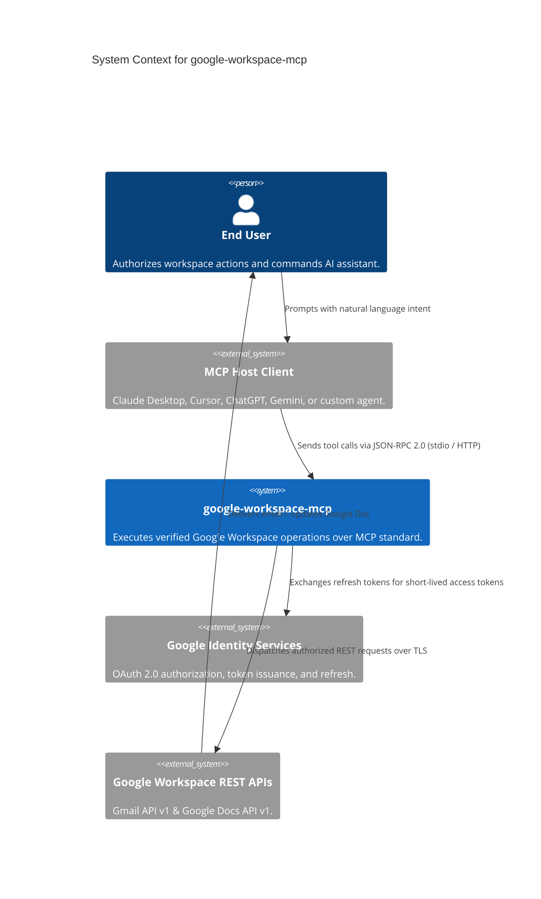
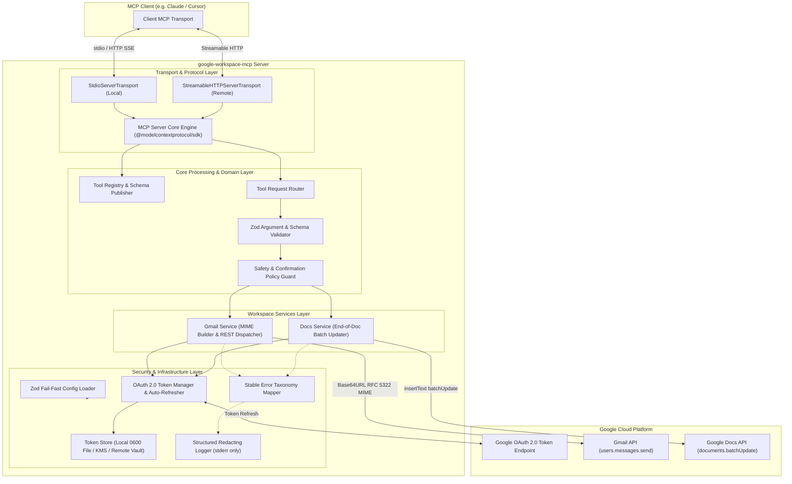
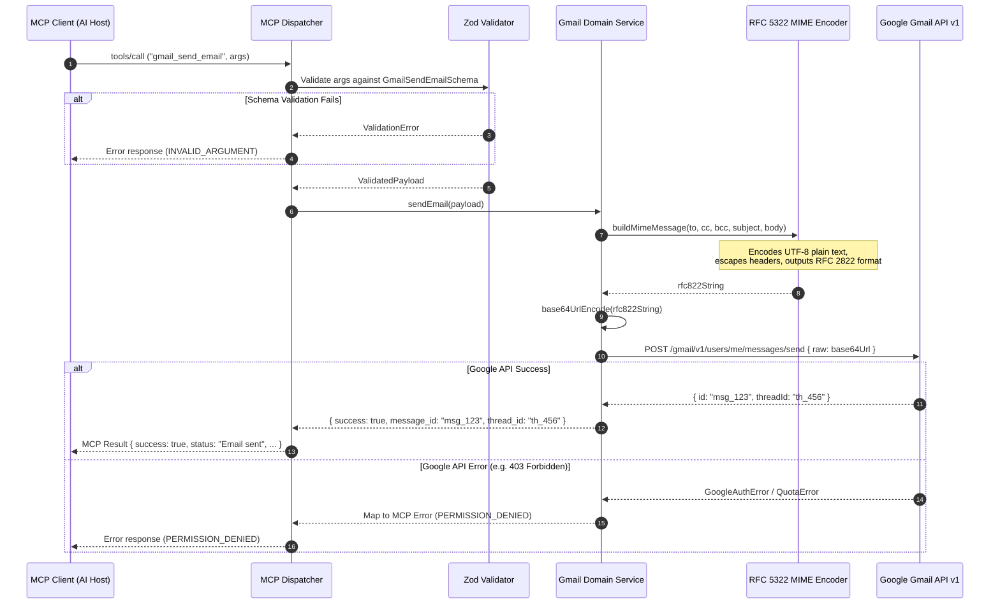
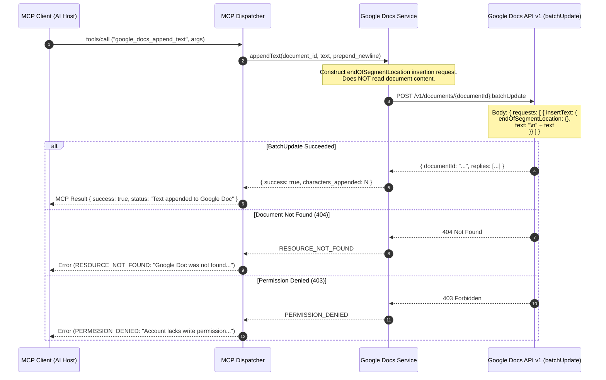
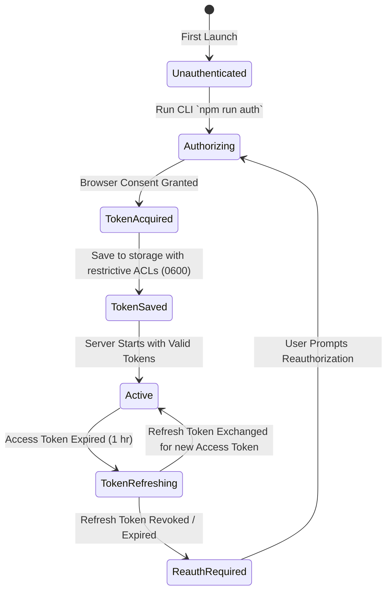
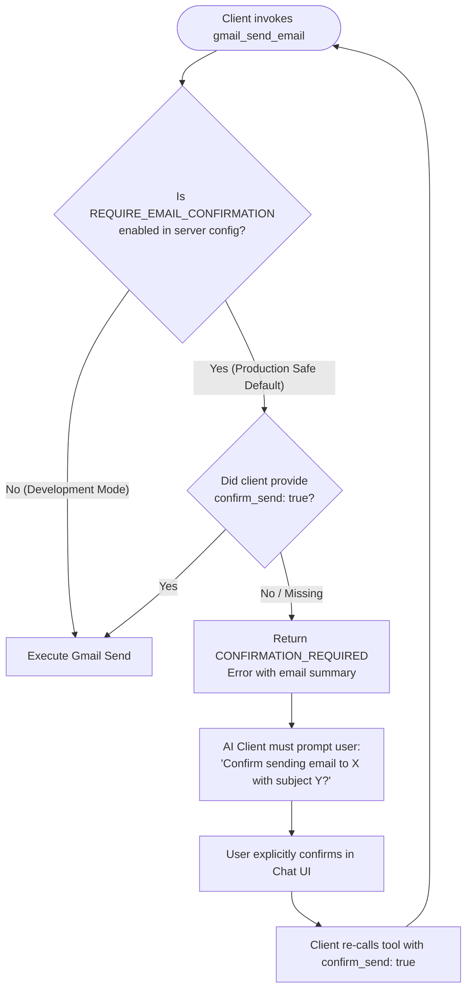
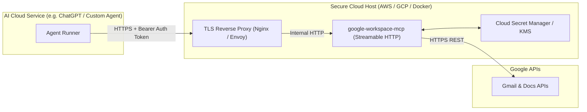

# Architecture Specification: Cross-Agent MCP Server for Google Workspace (`google-workspace-mcp`)

**Document Version:** 1.0.0  
**Status:** Approved for Implementation  
**Derived From:** [`Docs/problemStatement.md`](file:///c:/Users/jaya.manocha/Documents/myProjects/MCP/Docs/problemStatement.md)  
**Target Runtime:** Node.js 20+ LTS / TypeScript 5.x  
**Primary Framework:** Official Model Context Protocol SDK (`@modelcontextprotocol/sdk`)  
**Target Clients:** Claude Desktop, Cursor, Gemini, ChatGPT, and any standards-compliant MCP client  

---

## Table of Contents

1. [Executive Summary & Architectural Vision](#1-executive-summary--architectural-vision)
2. [Architectural Principles & Non-Negotiable Invariants](#2-architectural-principles--non-negotiable-invariants)
3. [System Context & High-Level Architecture](#3-system-context--high-level-architecture)
4. [Component Decomposition & Layered Architecture](#4-component-decomposition--layered-architecture)
5. [Protocol & Transport Layer Architecture](#5-protocol--transport-layer-architecture)
6. [Tool Contracts & Interface Specifications](#6-tool-contracts--interface-specifications)
7. [Google Workspace Integration Subsystem](#7-google-workspace-integration-subsystem)
   - [7.1 Gmail Integration Subsystem](#71-gmail-integration-subsystem)
   - [7.2 Google Docs Integration Subsystem](#72-google-docs-integration-subsystem)
8. [Authentication, Authorization & Secret Management](#8-authentication-authorization--secret-management)
9. [Safety Guardrails & Confirmation Policy](#9-safety-guardrails--confirmation-policy)
10. [Resilience, Idempotency & Error Handling](#10-resilience-idempotency--error-handling)
11. [Observability, Logging & Privacy Guardrails](#11-observability-logging--privacy-guardrails)
12. [Configuration Management](#12-configuration-management)
13. [Client Interoperability & Deployment Topologies](#13-client-interoperability--deployment-topologies)
14. [Testing & Verification Architecture](#14-testing--verification-architecture)
15. [Physical Project Structure](#15-physical-project-structure)
16. [Future Extensibility Roadmap](#16-future-extensibility-roadmap)

---

## 1. Executive Summary & Architectural Vision

The `google-workspace-mcp` server provides an enterprise-grade, client-agnostic integration bridge between modern AI assistants (Claude, Cursor, ChatGPT, Gemini, Antigravity) and Google Workspace productivity applications. 

Rather than embedding vendor-specific Google API integrations into separate AI clients or exposing unrestricted, raw API endpoints, this server standardizes interactions via the **Model Context Protocol (MCP)** specification.

```
+-----------------------------------------------------------------------------------------+
|                                    AI Client Ecosystem                                   |
|   [Claude Desktop]      [Cursor IDE]      [ChatGPT / Custom]      [Gemini / Antigravity] |
+-----------------------------------------------------------------------------------------+
                                             |
                                  MCP Protocol (JSON-RPC 2.0)
                                [stdio | Streamable HTTP / SSE]
                                             v
+-----------------------------------------------------------------------------------------+
|                                  google-workspace-mcp                                   |
|  +------------------------+  +--------------------------+  +-------------------------+  |
|  |     Transport Layer    |  |  Schema Validation (Zod) |  |   Confirmation Engine   |  |
|  +------------------------+  +--------------------------+  +-------------------------+  |
|  +------------------------+  +--------------------------+  +-------------------------+  |
|  |   Tool Dispatcher      |  |  PII-Redacting Logger    |  |  Error Taxonomy Mapper  |  |
|  +------------------------+  +--------------------------+  +-------------------------+  |
|  +-----------------------------------------------------------------------------------+  |
|  |                           Service & Google Auth Layer                             |  |
|  |    [OAuth 2.0 Token Store]      [Gmail Service]        [Google Docs Service]      |  |
|  +-----------------------------------------------------------------------------------+  |
+-----------------------------------------------------------------------------------------+
                                  |                     |
                        Google OAuth 2.0          Google Workspace APIs
                       (Least-Privilege)         (Gmail v1 / Docs v1)
                                  v                     v
+-----------------------------------------------------------------------------------------+
|                                Google Cloud Infrastructure                              |
|          [OAuth Consent]          [Gmail Mailbox]          [Google Docs Engine]          |
+-----------------------------------------------------------------------------------------+
```

### Scope Boundaries (V1 Focus)
- **Supported Capabilities:** 
  1. Sending plain-text email through the user's authorized Gmail account (`gmail_send_email`).
  2. Non-destructively appending plain text to the end of an existing Google Doc (`google_docs_append_text`).
- **Explicit Out of Scope:** Mailbox reading/searching, Drive browsing, document deletion/overwrite, calendar/contacts management, and autonomous planning loops. The server functions purely as a deterministic tool provider.

---

## 2. Architectural Principles & Non-Negotiable Invariants

| Principle | Architectural Rule | Rationale |
| :--- | :--- | :--- |
| **Client Neutrality** | Zero vendor-specific imports or branching for Claude, OpenAI, Google, etc. in business logic. | Ensures 100% interoperability across any compliant MCP host. |
| **Least Privilege Access** | Only request `https://www.googleapis.com/auth/gmail.send` and `https://www.googleapis.com/auth/documents`. Broad read scopes (e.g. `gmail.readonly`, `drive.readonly`) are forbidden. | Limits blast radius; guarantees the server cannot read private inboxes or files. |
| **Zero Non-Deterministic Overwrite** | Append operations must strictly target the end-of-segment location (`insertText`). Document replacement or range deletion APIs are blocked. | Guarantees existing document content is never overwritten or deleted. |
| **Strict PII Redaction** | Email bodies, document content, recipient lists, auth tokens, and client secrets must never be logged to console, disk, or error messages. | Protects user privacy and meets SOC2 / GDPR data handling standards. |
| **Transport Separation** | When running over `stdio`, `stdout` is exclusively dedicated to framed MCP JSON-RPC messages. All telemetry and logging MUST route to `stderr`. | Prevents JSON-RPC parser crashes in client agents caused by rogue stdout prints. |
| **Fail-Closed Confirmation** | Outbound communications (email sending) require validation of human intent before execution. | Safeguards against accidental/hallucinated email dispatch by AI models. |

---

## 3. System Context & High-Level Architecture

### C4 Level 1: System Context Diagram



### C4 Level 2: Container & Subsystem Architecture



---

## 4. Component Decomposition & Layered Architecture

The server adheres to a clean, decoupled 6-layer architecture:

```
+---------------------------------------------------------------------------------+
| 1. Transport & Protocol Layer                                                   |
|    - StdioServerTransport & StreamableHTTPServerTransport                       |
|    - Session lifecycle management and JSON-RPC 2.0 protocol parsing             |
+---------------------------------------------------------------------------------+
                                      |
+---------------------------------------------------------------------------------+
| 2. Tool Dispatching & Registration Layer                                        |
|    - Tool definition exposure via MCP `tools/list`                              |
|    - JSON Schema generation from Zod definitions                                |
|    - Routing `tools/call` to corresponding handlers                             |
+---------------------------------------------------------------------------------+
                                      |
+---------------------------------------------------------------------------------+
| 3. Validation & Guardrail Layer                                                 |
|    - Runtime argument validation (email regex, payload byte sizes, doc IDs)     |
|    - Confirmation Policy Evaluation (`confirm_send` enforcement)                |
+---------------------------------------------------------------------------------+
                                      |
+---------------------------------------------------------------------------------+
| 4. Workspace Domain Service Layer                                               |
|    - GmailService: RFC 5322 MIME construction, base64url encoding, send call    |
|    - DocsService: End-of-segment position calculation, batchUpdate dispatch     |
+---------------------------------------------------------------------------------+
                                      |
+---------------------------------------------------------------------------------+
| 5. Identity & Credential Management Subsystem                                   |
|    - OAuth2Client initialization (`google-auth-library` / `googleapis`)         |
|    - Secure persistent token store (file-based with 0600 mode or KMS/vault)     |
|    - Automatic access token refreshing on expiration                            |
+---------------------------------------------------------------------------------+
                                      |
+---------------------------------------------------------------------------------+
| 6. Cross-Cutting Infrastructure Layer                                           |
|    - RedactingLogger: Zero stdout pollution, PII masking, structured JSON       |
|    - ErrorTaxonomyMapper: Translates Google/System errors into stable MCP codes |
|    - ConfigLoader: Fail-fast environment variable validation at startup         |
+---------------------------------------------------------------------------------+
```

---

## 5. Protocol & Transport Layer Architecture

### 5.1 Local Transport: `stdio`
- **Mechanism:** Leverages standard input (`stdin`) and standard output (`stdout`) using framed JSON-RPC 2.0 messages via `StdioServerTransport`.
- **Target Use Case:** Local desktop agents such as Claude Desktop, Cursor IDE, and local development CLI runners.
- **Critical Requirement:**
  ```typescript
  // Stdout is strictly reserved for JSON-RPC transport frames.
  // All internal logging, debugging, and tracing MUST write to process.stderr.
  console.log = () => {
    throw new Error("Direct console.log is forbidden in stdio transport mode. Use logger.info/warn/error.");
  };
  ```

### 5.2 Remote Transport: `streamable-http` (Streamable HTTP / SSE)
- **Mechanism:** Implements an HTTP server supporting Server-Sent Events (SSE) for server-to-client streaming and `POST` endpoints for client-to-server JSON-RPC requests.
- **Target Use Case:** Multi-user hosted servers, remote cloud agents (ChatGPT Actions, remote web agents).
- **Security Invariants for Remote Mode:**
  1. **Mandatory TLS:** Remote transport MUST terminate on TLS 1.3/1.2; plaintext HTTP is prohibited outside `localhost`.
  2. **Bearer Authentication:** All incoming HTTP requests must supply an `Authorization: Bearer <MCP_API_KEY>` header validated against server configuration.
  3. **CORS Restrictions:** Restrict allowed origins via `ALLOWED_ORIGINS` environment configuration.

---

## 6. Tool Contracts & Interface Specifications

### 6.1 Tool: `gmail_send_email`

#### Tool Metadata
- **Identifier:** `gmail_send_email`
- **Description:** "Sends a plain-text email message from the authenticated user's Gmail account. Supports To, CC, BCC, subject, and body. Outbound email is permanent and cannot be undone."

#### Input Schema (Zod Definition)
```typescript
import { z } from "zod";

export const GmailSendEmailSchema = z.object({
  to: z
    .array(z.string().email("Invalid email address format").max(320))
    .min(1, "At least one recipient is required in 'to'")
    .max(50, "Exceeded maximum allowed recipients"),
  cc: z
    .array(z.string().email("Invalid CC email address format").max(320))
    .max(50)
    .optional()
    .default([]),
  bcc: z
    .array(z.string().email("Invalid BCC email address format").max(320))
    .max(50)
    .optional()
    .default([]),
  subject: z
    .string()
    .trim()
    .min(1, "Subject line cannot be empty or whitespace only")
    .max(500, "Subject line exceeds maximum limit of 500 characters"),
  body: z
    .string()
    .min(1, "Email body cannot be empty")
    .max(1_000_000, "Email body exceeds maximum size of 1MB"),
  confirm_send: z
    .boolean()
    .optional()
    .describe("Explicit confirmation flag. Required when REQUIRE_EMAIL_CONFIRMATION=true."),
  request_id: z
    .string()
    .uuid()
    .optional()
    .describe("Caller-supplied idempotency/correlation identifier for duplicate tracking.")
});

export type GmailSendEmailInput = z.infer<typeof GmailSendEmailSchema>;
```

#### Output Schema
```json
{
  "$schema": "http://json-schema.org/draft-07/schema#",
  "type": "object",
  "properties": {
    "success": { "type": "boolean" },
    "message_id": { "type": "string", "description": "Google Gmail message ID" },
    "thread_id": { "type": "string", "description": "Google Gmail thread ID" },
    "status": { "type": "string", "example": "Email sent" },
    "request_id": { "type": "string" }
  },
  "required": ["success", "status"]
}
```

---

### 6.2 Tool: `google_docs_append_text`

#### Tool Metadata
- **Identifier:** `google_docs_append_text`
- **Description:** "Appends plain text to the very end of an existing Google Doc without modifying, deleting, or overwriting existing content. Requires an accessible Google Doc ID."

#### Input Schema (Zod Definition)
```typescript
import { z } from "zod";

// Google Docs IDs are alphanumeric characters, dashes, and underscores (typically 44 chars)
const GOOGLE_DOC_ID_REGEX = /^[a-zA-Z0-9-_]{20,100}$/;

export const GoogleDocsAppendTextSchema = z.object({
  document_id: z
    .string()
    .trim()
    .transform((val) => {
      // Automatic extraction if full URL is passed: https://docs.google.com/document/d/<ID>/edit
      const urlMatch = val.match(/\/document\/d\/([a-zA-Z0-9-_]+)/);
      return urlMatch ? urlMatch[1] : val;
    })
    .pipe(z.string().regex(GOOGLE_DOC_ID_REGEX, "Invalid Google Docs document ID format")),
  text: z
    .string()
    .min(1, "Append text cannot be empty")
    .max(500_000, "Append text exceeds maximum limit of 500KB per request"),
  prepend_newline: z
    .boolean()
    .default(true)
    .describe("Whether to insert a newline separator before the appended text if the document does not end with one."),
  request_id: z
    .string()
    .uuid()
    .optional()
    .describe("Caller-supplied idempotency/correlation identifier.")
});

export type GoogleDocsAppendTextInput = z.infer<typeof GoogleDocsAppendTextSchema>;
```

#### Output Schema
```json
{
  "$schema": "http://json-schema.org/draft-07/schema#",
  "type": "object",
  "properties": {
    "success": { "type": "boolean" },
    "document_id": { "type": "string" },
    "status": { "type": "string", "example": "Text appended to Google Doc" },
    "characters_appended": { "type": "integer" },
    "request_id": { "type": "string" }
  },
  "required": ["success", "document_id", "status", "characters_appended"]
}
```

---

## 7. Google Workspace Integration Subsystem

### 7.1 Gmail Integration Subsystem



#### Implementation Specifications
1. **MIME Message Construction:**
   - Plain text representation: `Content-Type: text/plain; charset="UTF-8"`.
   - Header encoding: RFC 2047 Q/B encoding for international subject characters.
   - Recipient headers: `To:`, `Cc:`, `Bcc:` headers formatted cleanly with email angle brackets (e.g., `Name <email@domain.com>`).
2. **Safe Encoding:**
   - Converted into URL-safe Base64 (`base64url`) without padding characters (`=`), as mandated by Gmail's `users.messages.send` API endpoint.
3. **No Mailbox Traversal:**
   - The user mailbox (`me`) endpoint is used exclusively. The server has no logic or permissions to list, get, read, or trash messages.

---

### 7.2 Google Docs Integration Subsystem



#### Non-Destructive Mechanics
- The server issues a `documents.batchUpdate` request containing a single `InsertTextRequest`:
  ```json
  {
    "requests": [
      {
        "insertText": {
          "endOfSegmentLocation": {
            "segmentId": ""
          },
          "text": "\nAppended text content..."
        }
      }
    ]
  }
  ```
- **Structural Guarantees:**
  - `endOfSegmentLocation` guarantees that insertion occurs exclusively at the document index following all existing content.
  - No `DeleteContentRangeRequest`, `ReplaceAllTextRequest`, or coordinate-indexed deletions are implemented in the service.
  - The tool explicitly refuses to create a document if the requested `document_id` does not exist, mitigating unintended proliferation of orphan files.

---

## 8. Authentication, Authorization & Secret Management

### 8.1 OAuth 2.0 User Delegation vs. Service Accounts

```
+------------------------------------------------------------------------------------+
|                               Authentication Strategy                              |
+------------------------------------+-----------------------------------------------+
| User-Delegated OAuth 2.0 (CHOSEN)  | Service Account with Domain-Wide Delegation   |
+------------------------------------+-----------------------------------------------+
| [x] Uses individual user consent   | [ ] Requires Google Workspace Admin privileges|
| [x] Operates in user's personal    | [ ] Service account impersonation can access  |
|     security boundary              |     ANY account across the entire domain      |
| [x] Minimal configuration overhead | [ ] High risk: Compromised key exposes all    |
|     for personal/team users        |     domain emails and documents               |
| [x] Immediate token revocation     | [ ] Incompatible with personal @gmail.com     |
|     via Google Account settings    |     accounts                                  |
+------------------------------------+-----------------------------------------------+
```

### 8.2 Scope Minimization Analysis

The server requests strictly the following two OAuth scopes:

| Scope URI | Purpose | Impact & Minimization Rationale |
| :--- | :--- | :--- |
| `https://www.googleapis.com/auth/gmail.send` | Send email on user's behalf. | **Strictly write-only.** Cannot read inbox messages, cannot list threads, cannot delete mail, cannot access contacts. |
| `https://www.googleapis.com/auth/documents` | Append text to Google Docs. | Allows programmatic document editing via Docs API. Confined strictly to `insertText` at end-of-segment by service logic. |

> **Prohibited Scopes:**  
> - `https://mail.google.com/` (Full mailbox access) — **FORBIDDEN**  
> - `https://www.googleapis.com/auth/gmail.readonly` — **FORBIDDEN**  
> - `https://www.googleapis.com/auth/drive` (Full drive access) — **FORBIDDEN**  

### 8.3 Token Storage & Persistence



1. **Local Development Storage:**
   - Path: `~/.config/google-workspace-mcp/tokens.json` (or configured via `TOKEN_STORAGE_PATH`).
   - File System Security: POSIX permissions set strictly to `0600` (`-rw-------`), ensuring only the running OS user can read or write the file.
   - Git Protection: Explicitly excluded via `.gitignore` (`*.token.json`, `tokens.json`, `.credentials/`).
2. **Remote / Containerized Storage:**
   - Supports pluggable token persistence via encrypted environment variable (`GOOGLE_OAUTH_TOKEN_ENCRYPTED_JSON`) or integration with cloud secret stores (AWS Secrets Manager / GCP Secret Manager / HashiCorp Vault).

---

## 9. Safety Guardrails & Confirmation Policy

Sending an email is an external side effect with irreversible impact. The server implements defense-in-depth safe-execution policies.



### Confirmation Invariants
1. **Configurable Policy:** Controlled by `REQUIRE_EMAIL_CONFIRMATION` (Default: `true`).
2. **Model Argument Caveat:** A boolean parameter `confirm_send: true` supplied by an LLM is not a cryptographic signature. However, by failing when `confirm_send` is missing, the server forces the AI model into a two-phase commit:
   - *Phase 1:* Tool execution fails with `CONFIRMATION_REQUIRED`, detailing the exact recipient, subject, and length.
   - *Phase 2:* The model displays the preview to the user. Upon explicit user confirmation, the model re-invokes the tool with `confirm_send: true`.
3. **No Automatic Email Drafting Alterations:** The server never modifies the subject, body, or recipient list inferred by the agent. What is submitted is what is delivered.

---

## 10. Resilience, Idempotency & Error Handling

### 10.1 Stable Error Taxonomy

All errors returned to the MCP client conform to a unified error shape:

```typescript
export interface MCPToolErrorResponse {
  success: false;
  error_code: ErrorCode;
  message: string;
  retryable: boolean;
  request_id?: string;
}

export type ErrorCode =
  | "INVALID_ARGUMENT"         // Malformed emails, missing params, payload too large
  | "MISSING_CONFIGURATION"    // Server missing client ID, secret, or redirect URI
  | "AUTH_REQUIRED"            // No valid credentials found; re-run auth flow
  | "AUTH_EXPIRED"             // Refresh token revoked or expired
  | "INSUFFICIENT_SCOPE"       // User did not grant send or docs scopes
  | "RESOURCE_NOT_FOUND"       // Google Doc ID does not exist
  | "PERMISSION_DENIED"        // User lacks write access to the target Doc or mailbox
  | "GOOGLE_API_RATE_LIMIT"    // 429 quota exceeded
  | "GOOGLE_API_UNAVAILABLE"   // 503 Google service temporarily down
  | "REQUEST_TOO_LARGE"        // Exceeds configured byte thresholds
  | "CONFIRMATION_REQUIRED"    // Email confirmation flag was not provided
  | "DUPLICATE_RISK"           // Ambiguous network failure; retry blocked
  | "INTERNAL_ERROR";          // Unexpected server crash or unhandled condition
```

### 10.2 Handling Ambiguous Failures & Duplicate Risks

```
[Request Initiated] ---> [Google API Processing] - - - x [Network Drop / Client Timeout]
                                  |
                                  v
                      (Message Sent in Gmail)
```

- **The Problem:** If an HTTP connection to Google drops *after* Google processes the send/append but *before* the server receives the response, retrying blindly will result in duplicate emails or duplicated document paragraphs.
- **Resilience Strategy:**
  1. **Non-Idempotent Operations:** Operations are marked `retryable: false` on ambiguous socket hangups or 504 Gateway Timeouts.
  2. **`request_id` Tracking:** An in-memory cache (with configurable TTL of 10 minutes) stores recently executed `request_id` tokens. If an identical `request_id` arrives within the window after a successful send, the server returns the cached response rather than dispatching a duplicate message to Google.
  3. **No Unbounded Retries:** The server implements exponential backoff strictly for idempotent read checks or confirmed transient errors (e.g., HTTP 429 with `Retry-After`), never for blind email dispatch.

---

## 11. Observability, Logging & Privacy Guardrails

### 11.1 Logging Discipline

To preserve standard compliance on `stdio` transport and protect user confidential data:

```
+-----------------------------------------------------------------------------------+
| Logger Output Stream: process.stderr                                              |
| Format: JSON lines (NDJSON)                                                       |
+-----------------------------------------------------------------------------------+
```

```json
{
  "timestamp": "2026-10-17T17:21:40.123Z",
  "level": "INFO",
  "tool": "gmail_send_email",
  "request_id": "9b1deb4d-3b7d-4bad-9bdd-2b0d7b3dcb6d",
  "duration_ms": 342,
  "status": "SUCCESS",
  "recipient_count": 2,
  "subject_length": 24,
  "body_bytes": 450
}
```

### 11.2 PII & Secret Redaction Table

| Field / Asset | Redaction Policy | Handling in Logs & Errors |
| :--- | :--- | :--- |
| **Email Body** | **STRICT MASK** | Never printed under any log level. |
| **Document Content** | **STRICT MASK** | Never printed under any log level. |
| **OAuth Access/Refresh Tokens** | **TOTAL MASK** | Redacted with `[REDACTED_SECRET]`. |
| **Client Secrets** | **TOTAL MASK** | Redacted at startup config logs. |
| **Recipient Addresses** | **HASH / COUNT** | Logged as count (e.g. `recipient_count: 2`) or SHA-256 truncated hash. Full emails omitted. |
| **Doc IDs** | **TRUNCATED** | First 4 and last 4 characters logged (e.g. `1a2b...9z8y`). |

---

## 12. Configuration Management

Configuration is loaded from environment variables and validated at server boot using Zod. Missing required variables cause the server to fail fast with informative, un-redacted error descriptions (excluding secrets).

### Configuration Matrix

| Variable | Type | Default | Description |
| :--- | :--- | :--- | :--- |
| `GOOGLE_CLIENT_ID` | String | *Required* | OAuth 2.0 Client ID from Google Cloud Console. |
| `GOOGLE_CLIENT_SECRET`| String | *Required* | OAuth 2.0 Client Secret (kept strictly secret). |
| `GOOGLE_REDIRECT_URI` | String | `http://localhost:3000/oauth2callback` | Authorized redirect URI for local OAuth flow. |
| `TOKEN_STORAGE_PATH`  | String | `~/.config/google-workspace-mcp/tokens.json` | Local path for persistent OAuth credentials. |
| `MCP_TRANSPORT`       | `stdio` \| `streamable-http` | `stdio` | Active MCP transport adapter. |
| `MCP_PORT`            | Number | `8080` | Listening port when running in `streamable-http` mode. |
| `MCP_HOST`            | String | `127.0.0.1` | Binding interface for HTTP transport. |
| `MCP_API_KEY`         | String | *Optional* | Shared secret for authenticating remote HTTP MCP clients. |
| `REQUIRE_EMAIL_CONFIRMATION` | Boolean | `true` | Requires `confirm_send: true` argument on email sends. |
| `MAX_EMAIL_RECIPIENTS`| Number | `50` | Maximum combined recipients (`to` + `cc` + `bcc`). |
| `MAX_EMAIL_BODY_BYTES`| Number | `1048576` (1MB) | Maximum payload size for an email body. |
| `MAX_DOC_APPEND_BYTES`| Number | `524288` (500KB) | Maximum payload size for a single document append. |
| `LOG_LEVEL`           | `debug` \| `info` \| `warn` \| `error` | `info` | Telemetry granularity for stderr logging. |

---

## 13. Client Interoperability & Deployment Topologies

### 13.1 Deployment Mode A: Local stdio (Claude Desktop, Cursor)

The AI client launches the server as a local child process.

```mermaid
graph LR
    subgraph ClientHost["Host Machine"]
        ClientApp["Claude Desktop / Cursor IDE"]
        ChildProcess["node dist/index.js (Child Process)"]
        TokenFile["Local Storage (~/.config/.../tokens.json)"]
    end
    
    subgraph Cloud["Google Cloud"]
        GoogleAPI["Google Workspace APIs"]
    end

    ClientApp -->|Spawns via stdio| ChildProcess
    ChildProcess <-->|Reads/Writes Tokens (0600)| TokenFile
    ChildProcess -->|HTTPS REST| GoogleAPI
```

#### Configuration Snippets

**Claude Desktop Configuration (`claude_desktop_config.json`):**
```json
{
  "mcpServers": {
    "google-workspace": {
      "command": "node",
      "args": ["/ABSOLUTE/PATH/TO/google-workspace-mcp/dist/index.js"],
      "env": {
        "GOOGLE_CLIENT_ID": "your-client-id.apps.googleusercontent.com",
        "GOOGLE_CLIENT_SECRET": "your-client-secret",
        "REQUIRE_EMAIL_CONFIRMATION": "true"
      }
    }
  }
}
```

**Cursor Configuration (`.cursor/mcp.json`):**
```json
{
  "mcpServers": {
    "google-workspace": {
      "command": "node",
      "args": ["/ABSOLUTE/PATH/TO/google-workspace-mcp/dist/index.js"],
      "env": {
        "GOOGLE_CLIENT_ID": "your-client-id.apps.googleusercontent.com",
        "GOOGLE_CLIENT_SECRET": "your-client-secret"
      }
    }
  }
}
```

### 13.2 Deployment Mode B: Remote Streamable HTTP (ChatGPT, Remote Agents)

The server runs as a containerized microservice behind a reverse proxy (e.g., Cloudflare, NGINX, Cloud Run).



---

## 14. Testing & Verification Architecture

The testing pyramid ensures safety, schema compliance, and API resilience:

```
                  / \
                 /   \
                / E2E \       Live Google Workspace Test Account
               /-------\      (Controlled Mailbox & Test Doc)
              /  Integ  \     
             /-----------\    MCP Protocol & Mocked Google REST APIs
            /    Unit     \   
           /---------------\  Zod Schemas, MIME Encoder, Redaction, Auth
```

### 14.1 Unit Test Suite (`tests/unit/`)
- **Schema Validation:** Test valid and edge-case inputs for `GmailSendEmailSchema` and `GoogleDocsAppendTextSchema` (e.g., malformed email regex, whitespace-only subjects, oversized text strings).
- **MIME Generation:** Verify that `buildMimeMessage()` correctly encodes Unicode subjects, adds headers properly, and encodes to valid base64url.
- **Redaction Verification:** Verify that mock logging statements passed sensitive objects scrub tokens, passwords, and message bodies.
- **Confirmation Logic:** Assert that `sendEmail` rejects calls when `REQUIRE_EMAIL_CONFIRMATION=true` and `confirm_send=false`.

### 14.2 Integration Test Suite (`tests/integration/`)
- **Mock Google Server:** Spin up local HTTP mock server (e.g. `msw` or `nock`) simulating Google's `/gmail/v1/users/me/messages/send` and `/v1/documents/:batchUpdate` endpoints.
- **Error Mapping:** Verify HTTP 401 maps to `AUTH_EXPIRED`, HTTP 403 to `PERMISSION_DENIED`, HTTP 404 to `RESOURCE_NOT_FOUND`, and HTTP 429 to `GOOGLE_API_RATE_LIMIT`.
- **MCP Protocol Conformance:** Run `@modelcontextprotocol/inspector` or SDK client to verify `tools/list` returns conforming JSON schemas.

### 14.3 Live End-to-End Test Suite (`tests/e2e/`)
- Executed strictly with a dedicated test Google account.
- **Gmail E2E:** Dispatches an email to a test sink (e.g. Mailtrap or test inbox); asserts message ID returned.
- **Google Docs E2E:** Creates a test document, records its character count, appends a unique GUID timestamp, verifies that previous text is unchanged and new text exists at the end.

---

## 15. Physical Project Structure

```text
google-workspace-mcp/
├── .env.example                     # Placeholder configuration file
├── .gitignore                       # Strict exclusion for credentials, logs, dist
├── LICENSE                          # Open source license (Apache-2.0 or MIT)
├── README.md                        # Setup guide, Google Cloud instructions, client configs
├── package.json                     # NPM dependencies and build scripts
├── tsconfig.json                    # Strict TypeScript compilation options
├── Docs/
│   ├── problemStatement.md         # Original specification & requirements
│   └── Architecture.md             # This document
├── bin/
│   └── auth-cli.ts                  # Interactive CLI to execute OAuth browser login flow
├── src/
│   ├── index.ts                     # Main entrypoint: initializes config, transport, & server
│   ├── server.ts                    # MCP Server setup, tool registration, protocol lifecycle
│   ├── config.ts                    # Zod schema for environment variables & fail-fast parser
│   ├── auth/
│   │   ├── google-oauth.ts          # OAuth2 client factory, refresh handlers, scope validator
│   │   └── token-store.ts           # File-based secure token storage with 0600 permissions
│   ├── tools/
│   │   ├── index.ts                 # Tool definitions and registration dictionary
│   │   ├── gmail-send-email.ts      # Tool handler: validation, confirmation check, dispatch
│   │   └── google-docs-append-text.ts # Tool handler: doc ID parsing, append dispatch
│   ├── services/
│   │   ├── gmail-service.ts         # Gmail API client, MIME formatting, base64url encoder
│   │   └── docs-service.ts          # Google Docs API client, batchUpdate endOfSegment builder
│   ├── validation/
│   │   └── schemas.ts               # Shared Zod schemas for inputs, outputs, and entities
│   └── utils/
│       ├── errors.ts                # Stable error taxonomy class & Google error translator
│       ├── logger.ts                # Structured PII-redacting logger writing to stderr
│       └── mime.ts                  # RFC 5322 plain-text message builder
└── tests/
    ├── fixtures/                    # Mock JSON-RPC payloads and sample API responses
    ├── unit/
    │   ├── validation.test.ts       # Input schema boundary tests
    │   ├── mime.test.ts             # Email MIME builder tests
    │   └── logger.test.ts           # PII redaction tests
    ├── integration/
    │   ├── mcp-protocol.test.ts     # Protocol handshake and tool listing tests
    │   └── error-mapping.test.ts    # Google API error code translation tests
    └── e2e/
        └── live-workspace.test.ts   # Live integration test against sandbox Google account
```

---

## 16. Future Extensibility Roadmap

The layered service architecture accommodates straightforward extension to additional Google Workspace capabilities without breaking changes to existing contracts:

```
+-----------------------------------------------------------------------------------+
|                              Future Extension Matrix                              |
+--------------------------+------------------------------+-------------------------+
| Planned Tool Name        | Target Google API            | Required Scope          |
+--------------------------+------------------------------+-------------------------+
| `gmail_create_draft`     | Gmail API (drafts.create)    | gmail.compose           |
| `google_docs_read_text`  | Docs API (documents.get)     | documents.readonly      |
| `google_drive_find_file` | Drive API (files.list)       | drive.metadata.readonly |
| `google_calendar_create` | Calendar API (events.insert) | calendar.events         |
+--------------------------+------------------------------+-------------------------+
```

Each new capability will be implemented as an independent tool module under `src/tools/` with its own isolated Zod schema, dedicated scope evaluation, and independent unit test suite.
